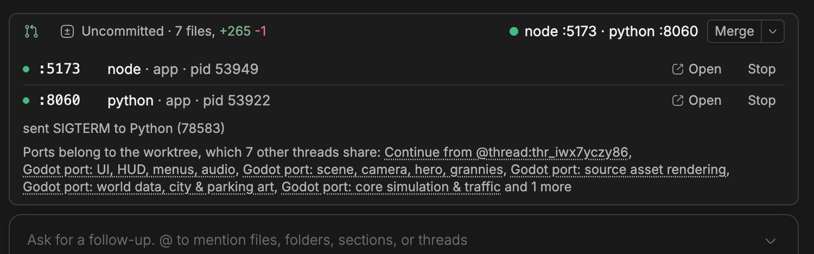

# Thread Ports

See which dev servers a thread's worktree is serving, right above its
composer, and open or stop them.



A **Ports** segment joins the row above the composer (beside the pull request
and changed-files segments) while anything listens in the thread's worktree:
`node :5173 · python :8060 · +2`. Click it for the full list:

- **Open** shows the server in the browser BB prefers.
- **Stop** sends SIGTERM to the listening process, or stops the container
  behind a published Docker port. A second click within three seconds
  confirms.
- The other threads working in the same worktree are listed as links, since
  ports belong to a worktree rather than to one thread.

## Requirements

- [Worktree Ports](https://github.com/to-infinity-labs/bb-plugin-worktree-ports)
  from the BB Community marketplace (`bb plugin install worktree-ports`).
  Thread Ports reads its listing and sends Stop through it; without it the
  segment stays hidden.
- macOS or Linux (Worktree Ports needs `lsof`).
- BB 0.50 and plugin SDK 0.6.157 or newer.

## How it works

- `server.ts` calls Worktree Ports' `ports_snapshot` and `ports_release` RPC
  methods through `bb.sdk.plugins.callRpc`, caches the snapshot for 1.5 s so
  several panes share one call, and keeps only the environment a thread asks
  about.
- `app.tsx` registers the segment with
  `app.slots.experimental_threadContextSegment` (group `4_ports`, after bb's
  git segments). One poller per environment runs every 4 s while a segment
  for it is mounted. `useVisible` hides the segment when nothing listens or
  Worktree Ports does not answer.

## Development

```sh
npm ci
npm run typecheck
npm run build
bb plugin install .
```

## Releases

See [CHANGELOG.md](./CHANGELOG.md).
