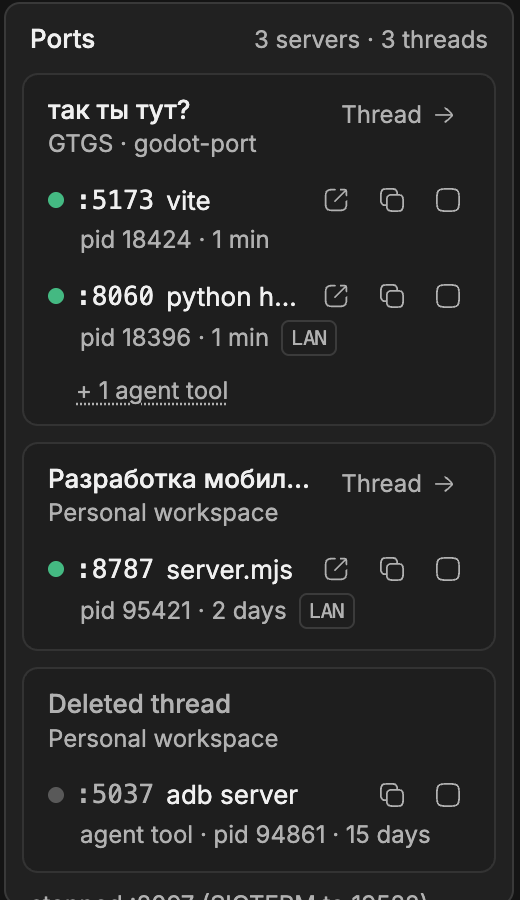

# Thread Ports

See every dev server a BB thread started, named after that thread: open,
copy, or stop it, and jump to the thread, from the sidebar or right above the
composer.



## What you get

- **Ports** in the sidebar footer: one card per serving thread with its title
  (click to go there), project and branch, and a row per port with **Open**,
  **Copy**, and **Stop** (one confirm click; **Force kill** if SIGTERM is not
  enough). A **LAN** chip marks a port reachable from the network and copies
  its `http://<lan-ip>:<port>` address.
- A **segment above the composer** with the thread's own servers, expanding
  into the same rows.
- A **plug glyph** on the sidebar rows of serving threads.
- `bb thread-ports [list] [--json]` and `bb thread-ports stop <port> [--force]`.

Agent tools (MCP and language servers, adb) and ephemeral loopback ports fold
behind a toggle. A server that outlived its thread shows under **Deleted
thread**.

## How it works

- `host.ts` runs on each enrolled machine: `lsof -nP -iTCP -sTCP:LISTEN`, then
  for each listening pid its start time and command (`ps -o lstart,command`),
  its `BB_THREAD_ID` / `BB_ENVIRONMENT_ID` (`ps -wwwE` on macOS,
  `/proc/<pid>/environ` on Linux) and its cwd. A process without a BB thread
  is kept only when its cwd sits inside a BB workspace. Facts are cached per
  pid and re-read when the start time changes, so a reused pid never inherits
  another thread.
- `stop` re-checks that the pid still listens on the port and still has the
  start time the UI saw, then sends SIGTERM (SIGKILL with `force`) and waits
  up to 2.5 s for the port to close.
- `server.ts` names everything (thread titles, project names, branches),
  groups ports by thread, and serves `snapshot` / `stop` over RPC, a
  `/snapshot` HTTP route for the row glyphs, and the CLI. Snapshots are cached
  for 1.5 s.
- `app.tsx` registers the sidebar footer disclosure, the
  `experimental_threadContextSegment` (group `4_ports`) and a content script
  for row glyphs. One poller (3 s) serves every view while one is mounted.

## Requirements

- macOS or Linux with `lsof` and `ps`.
- BB 0.50 and plugin SDK 0.6.157 or newer.

## Development

```sh
npm ci
npm run typecheck
npm test
npm run build
bb plugin install .
```

## Releases

See [CHANGELOG.md](./CHANGELOG.md).
